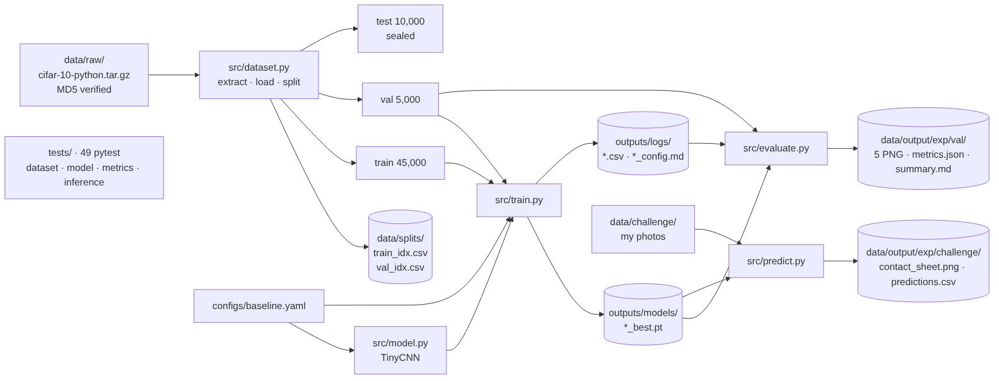
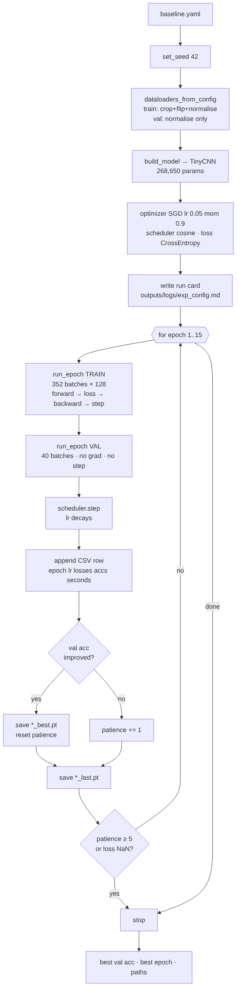
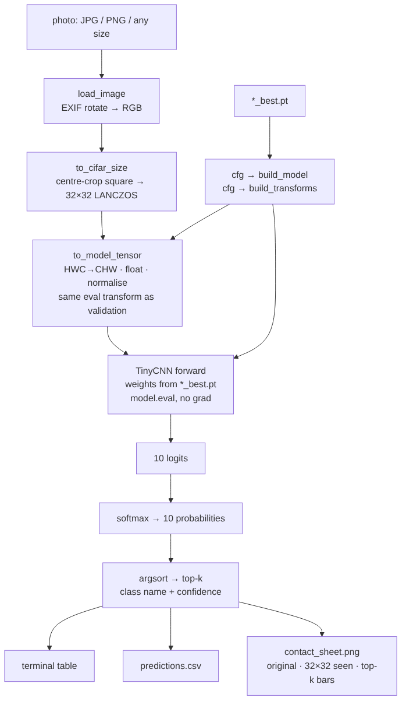
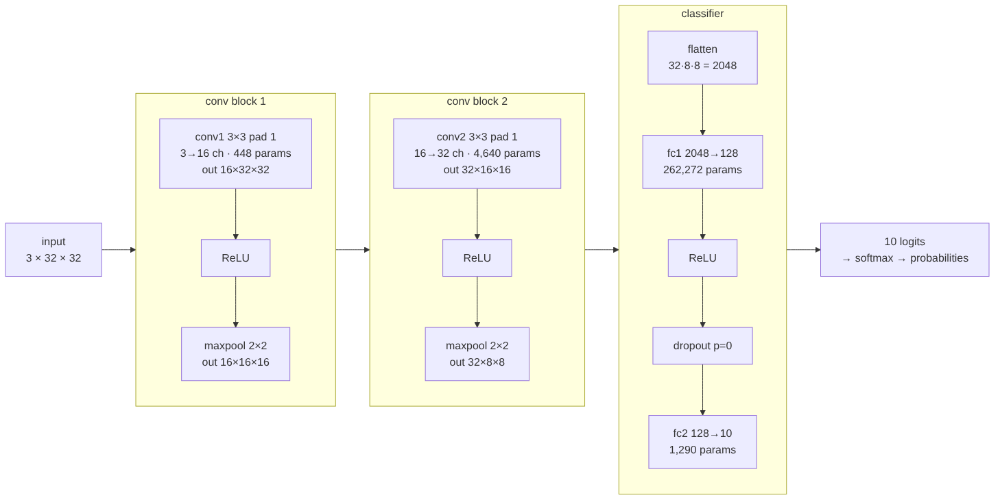

# Pipeline, workflows, network — and where the baseline stands

Diagrams only; explanations are in my own words in `learning-notes.md`.
Diagram sources are the `.mmd` files in `doc/diagrams/` (Mermaid) — edit the text, re-render with
`mmdc -i file.mmd -o file.png -b white -w 1600`, or paste into https://mermaid.live.

## 1. Overall pipeline

## 2. Training workflow (`python -m src.train`)

## 3. Prediction workflow (`python -m src.predict`)

## 4. Network — TinyCNN v1 (268,650 parameters)

Planned change for the experiments: insert **BatchNorm** between each conv and its ReLU
(conv → BN → ReLU → pool), and optionally a third conv block (64 ch, out 64×4×4, flatten 1024).

---

## 5. Baseline results — `baseline_tinycnn`, my laptop run (2026-11-01)

Config: `configs/baseline.yaml` · 15 epochs · SGD lr 0.05 momentum 0.9 wd 5e-4 · cosine · batch 128 ·
crop+flip augmentation · normalise · dropout 0 · seed 42. Full run card: `outputs/logs/baseline_tinycnn_config.md`.

### Training log (`outputs/logs/baseline_tinycnn.csv`)

| epoch | lr | train loss | train acc | val loss | val acc | s |
|---|---|---|---|---|---|---|
| 1 | 0.0500 | 1.625 | 40.4% | 1.276 | 54.8% | 6.8 |
| 5 | 0.0417 | 1.019 | 63.9% | 0.899 | 68.4% | 6.9 |
| 10 | 0.0173 | 0.791 | 72.6% | 0.763 | 74.0% | 6.7 |
| 15 | 0.0005 | 0.661 | 76.8% | 0.640 | **77.7%** | 7.0 |

~7 s per epoch on 16 threads; whole run ≈ 1.5 min. Train and val track each other closely
(no overfitting); both still falling at epoch 15 (not yet converged).

### Validation set (5,000 images) — `data/output/baseline_tinycnn/val/`

| metric | value | figure |
|---|---|---|
| accuracy | **77.70%** | `per_class_accuracy.png` |
| top-2 accuracy | 90.60% | — |
| macro-F1 | 0.776 | — |
| ECE (calibration error) | 0.010 — well calibrated | `calibration.png` |
| learning curves | train/val loss + acc per epoch | `learning_curves.png` |
| confusion matrix | 10×10 counts | `confusion_matrix.png` |
| worst mistakes | 16 most confident wrong predictions | `worst_mistakes.png` |

| class | accuracy | precision | F1 |
|---|---|---|---|
| airplane | 83.0% | 79.5% | 0.812 |
| automobile | 90.0% | 89.5% | 0.897 |
| bird | 66.6% | 73.2% | 0.697 |
| cat | **59.0%** | 60.6% | 0.598 |
| deer | 72.4% | 71.8% | 0.721 |
| dog | 68.4% | 66.7% | 0.675 |
| frog | 83.2% | 82.9% | 0.830 |
| horse | 81.6% | 81.0% | 0.813 |
| ship | 87.0% | 85.3% | 0.861 |
| truck | 85.8% | 85.8% | 0.858 |

Most confused pairs (true → predicted): cat→dog 93, dog→cat 79, deer→horse 37.
Vehicles and frogs are easy; the four-legged animals are hard, cat/dog hardest.

Reference: the same config run by Claude on a 2-core cloud machine gave 76.9% (±0.8% from CPU
arithmetic differences; same seed). Figures in `doc/experiments/baseline_tinycnn_cloud_run/`.

### Challenge set (my own photos) — `data/output/baseline_tinycnn/challenge/`

| image | top-1 | top-2 | top-3 | note |
|---|---|---|---|---|
| cat photo, full frame 2160×3840 | automobile 96% | ship 3% | airplane 0% | centre crop = litter tray; cat ~10 px tall |
| same photo, tight crop 1338×1338 | **cat 54%** | dog 33% | horse 11% | subject fills the frame → correct |
| _synthetic frog (PNG alpha) | frog 99.8% | bird | deer | pre-processing check |
| _synthetic horse (portrait, EXIF rot.) | deer 79% | horse 18% | dog | borderline; Claude's checkpoint said horse 58% |
| _synthetic ship (640×480, borders) | ship 99% | airplane | truck | pre-processing check |
| _synthetic truck (greyscale) | truck 93% | cat | automobile | pre-processing check |

Finding: framing matters more than the model — same photo, same weights, crop changed the answer
from a confident wrong class to the right one.

---

## 6. Verification done so far

### On my laptop (WSL, `~/.venvs/silverpond`)

| check | command | result |
|---|---|---|
| environment | `time python -c "import torch"` | 61.7 s with venv on /mnt/c → 1.0 s after moving venv to ~/ |
| data pipeline | `python scripts/verify_data.py` | ALL CHECKS PASSED: 45k/5k/10k, 500 per class in val, no overlap, batch shapes, sample grid |
| model shapes | `python -m src.model` | layer table identical to Claude's, 268,650 params |
| plumbing | `python -m src.train --smoke` | 2 epochs × 5 batches in <1 s; loss 2.308 ≈ ln 10, identical numbers to Claude's run |
| full training | `python -m src.train` | 15 epochs, best val 77.7% |
| evaluation | `python -m src.evaluate` | 5 PNGs + metrics.json + summary.md |
| prediction | `python -m src.predict` | 6 images incl. own photo; contact sheet |
| layer page | `python scripts/visualize_layers.py --checkpoint …` | regenerated with trained weights |
| unit tests | `pytest -q` | **pending — run after the latest pull (expect 49 passed)** |

### In Claude's workspace (before each hand-over)

| check | result |
|---|---|
| `pytest -q` | 49 passed (16 dataset, 19 model, 9 metrics, 5 inference) |
| mutation check | re-introducing the in-place-ReLU bug turns exactly 1 test red; fix restores 49 green |
| split determinism | regenerated CSVs md5 `cc0bef88…` / `a57d306e…` match the committed files |
| full baseline run | 76.9% val, figures inspected before hand-over |
| layer page | rendered at phone + desktop width, no overflow, script parses |

### Bugs found and fixed along the way (all in chat history)

| where | bug | how it was caught |
|---|---|---|
| `dataset.py` `build_dataloaders` | dict merge used the same keys for Datasets and DataLoaders — loaders silently overwrote datasets | `verify_data.py` crashed on first run |
| `model.py` `forward_with_activations` | `ReLU(inplace=True)` overwrote the stored conv output → conv maps looked post-ReLU | spotted in the layer page (conv1 showed 68% zeros, impossible); regression test added |
| `evaluate.py` worst-mistakes plot | second-row titles overlapped first-row images | looking at the PNG |
| `predict.py` | read-only numpy → torch warning | running it |
